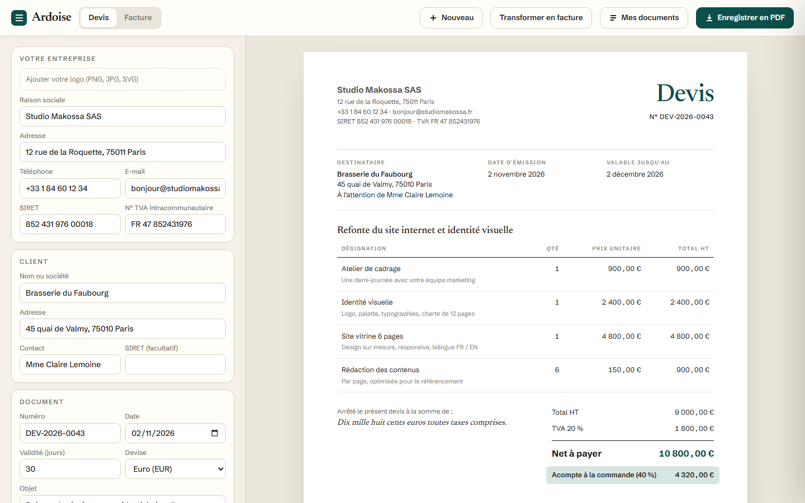
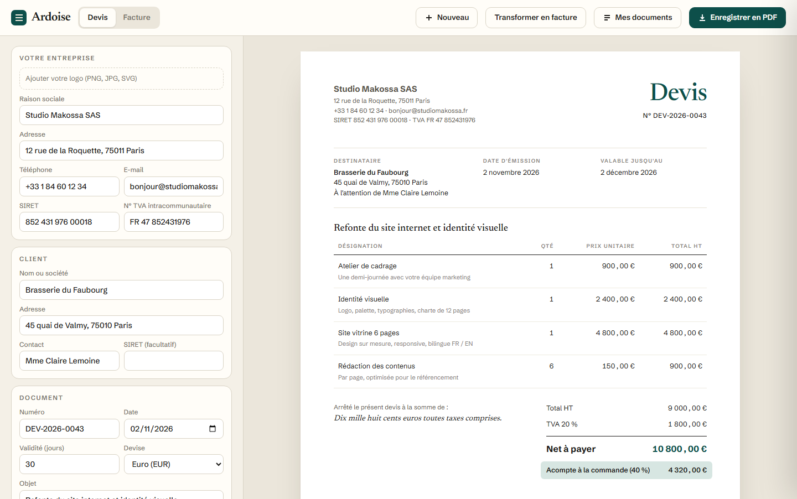
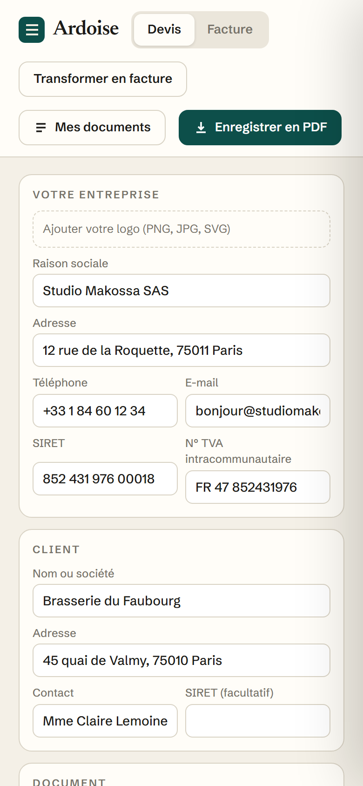

# Ardoise

**Générateur de devis et factures** — Outil de facturation pour indépendants et PME : édition à gauche, aperçu A4 fidèle à droite, calculs fiscaux français (TVA 20 %), montant en lettres, transformation devis vers facture, suivi des paiements et export PDF.

**Démo en ligne : [https://lordlennyx.github.io/ardoise-devis-factures/](https://lordlennyx.github.io/ardoise-devis-factures/)**

Spot de présentation (30 s) : [media/spot-30s.mp4](https://lordlennyx.github.io/ardoise-devis-factures/media/spot-30s.mp4)

## Ce que le projet montre

- Aperçu A4 en direct, trois gabarits (classique, bandeau, marge) et cinq couleurs, logo importé
- TVA 20 %, retenue de garantie, remise globale, acompte ; euro, livre, franc suisse ou dollar
- Montant en toutes lettres selon les règles françaises (vingt et un, quatre-vingts, deux cents…)
- Numérotation automatique par année, mentions SIRET et TVA intracommunautaire, bon pour accord, pénalités de retard légales
- Devis transformé en facture d'un clic, statuts (envoyé, accepté, payé, en retard), tampon « Payée »
- Tableau de bord : encaissé, en attente, taux d'acceptation ; clients réutilisés automatiquement ; sauvegarde locale

## Réalisation

- **Stack :** HTML, CSS (impression paginée A4), JavaScript natif
- **Typographies :** Newsreader, Schibsted Grotesk
- **Évolutions possibles :** envoi par e-mail ou WhatsApp, paiement en ligne Mobile Money, comptes multi-utilisateurs, synchronisation cloud

| Bureau | Mobile |
|---|---|
|  |  |

---

Client et contenus fictifs, créés pour la démonstration. Conception, design et développement : **Njundiyimun Béchard** — [github.com/LordLennyx](https://github.com/LordLennyx)
